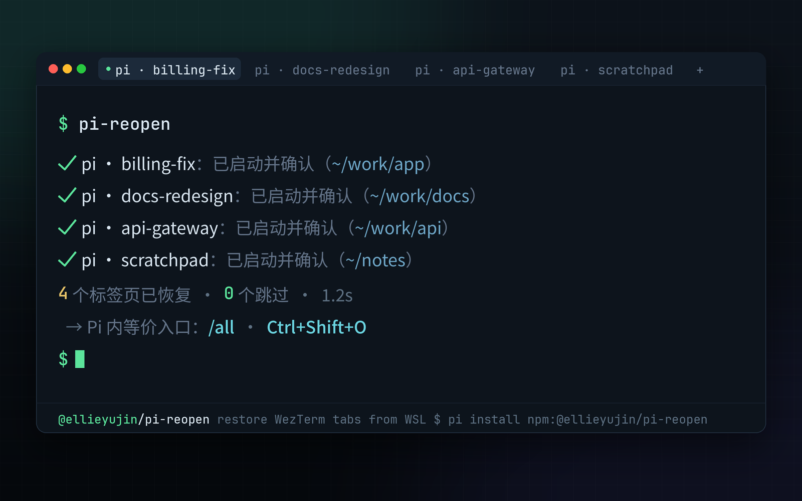

# pi-reopen

<p align="center">
  <a href="README.md">English</a> | <a href="README.zh-CN.md">简体中文</a>
</p>

One command to recover the Pi terminals that were still open when WezTerm closed: restores the original working directory, loads the original conversation, and waits for your input.

A [Pi](https://github.com/earendil-works/pi) package: the Pi extension registers every open Pi in real time, and the standalone `pi-reopen` CLI reopens them as tabs through Windows [WezTerm](https://wezm.dev/), with environment preflight, deduplication, and concurrency protection.



## Requirements

- **WSL (Windows) + Windows WezTerm**: the only supported restore target
- Node ≥ 22.19, with [Pi](https://github.com/earendil-works/pi) installed
- Non-WSL Linux / macOS / native Windows: not supported (restore and liveness checks depend on WSL / Linux)
- Restore runs as the default user of the target WSL distro; run this tool as that user

## Usage

```bash
pi-reopen
```

```text
  ✔ pi-workspace：已启动并确认（/home/ellie/work/MY/code/pi-workspace）
  ⚠ other-proj：已创建标签页，超时未确认 pi 启动（/home/ellie/work/other-proj）
已处理 2 个
```

CLI output is in Simplified Chinese: `已启动并确认` = launched and confirmed; `超时未确认 pi 启动` = tab created, timed out waiting for pi confirmation; `已处理 N 个` = N processed.

Equivalent entry points inside Pi:

- `/all` — restore registered Pis
- `/all recent` — pick up from conversation history of the last 24 hours (for unregistered windows)
- `/all clear` — clear the registry (does not delete conversation files)
- `Ctrl+Shift+O` — one-click restore

## Commands

| Command | Description |
| --- | --- |
| `pi-reopen` (i.e. `pi-reopen restore`) | Reopen the Pis still open at last close; running ones are skipped |
| `pi-reopen restore --dry-run` | Show the plan only, do not open tabs |
| `pi-reopen restore --no-wait` | Skip waiting for each pi's start confirmation |
| `pi-reopen list` | List registered members and status; long content is truncated to terminal width by default |
| `pi-reopen list --wide` | No truncation |
| `pi-reopen doctor` | Environment check (WSL distro / interop socket / WezTerm / pi) |
| `pi-reopen clear` | Clear the registry and start claims (does not delete conversation files or legacy-format records) |

`list` statuses (labels in Chinese): running (运行中) / pending restore (待恢复) / start claimed (启动占用中) / working directory missing (工作目录缺失) / session file missing (会话文件缺失) / duplicate entry (重复条目).

Exit codes: 0 success; 1 restore failed or unknown command; 2 environment preflight failed.

## Installation

### From npm

Use the full package name `@ellieyujin/pi-reopen` with the `next` dist-tag. The unscoped `pi-workspace` on npm is a different author's project.

```bash
pi install npm:@ellieyujin/pi-reopen@next
npm install -g @ellieyujin/pi-reopen@next --omit=peer
pi-reopen doctor
```

- `pi install` registers and loads the extension, but does not guarantee the CLI is on a regular shell's PATH; `npm install -g` installs the external CLI (the npm global bin directory must also be on PATH)
- The CLI does not depend on Pi's peer packages, hence `--omit=peer` to avoid installing the host as well; the two installs must be updated separately and kept at the same version

**Registration requires the extension**: installing only the CLI cannot record sessions. After install, run `/reload` or restart in each already-open Pi; a fresh install cannot precisely recover previously unregistered windows. Do not load an old `open-all.ts` copy/symlink at the same time as the package; before migrating, check `pi list` and the personal extension directory, disable the old entry only, and do not delete session or auth files.

### From source

The following commands run inside WSL and install the currently checked-out source:

```bash
git clone https://github.com/AuthurX/pi-workspace.git
cd pi-workspace
pi install .
mkdir -p "$HOME/.local/bin"
ln -s "$PWD/bin/pi-reopen.js" "$HOME/.local/bin/pi-reopen"
export PATH="$HOME/.local/bin:$PATH"
pi-reopen doctor
```

Save the PATH configuration in your shell startup file for future use. If the CLI symlink already exists, check its target first; do not blindly overwrite it.

If you only need the extension, you can also install the pushed Git version directly:

```bash
pi install git:github.com/AuthurX/pi-workspace
```

## Optional Configuration

| Environment variable | Purpose |
| --- | --- |
| `PI_WORKSPACE_WEZTERM` | Absolute path of Windows WezTerm inside WSL, e.g. `/mnt/c/Program Files/WezTerm/wezterm.exe` |
| `PI_WORKSPACE_PI_BIN` | Absolute path of the Pi executable inside WSL, no arguments; aliases and shell functions are not supported |
| `PI_CODING_AGENT_DIR` | Use a different Pi config/registry directory; CLI and extension must stay consistent |
| `PI_WORKSPACE_SRC` | Development only: overrides the shared `src/` directory; not needed for normal package installs |

For example, if Pi is installed via nvm, pnpm, or a custom npm prefix, set it explicitly:

```bash
export PI_WORKSPACE_PI_BIN="$(type -P pi)"
export PI_WORKSPACE_WEZTERM="/mnt/c/Program Files/WezTerm/wezterm.exe"
pi-reopen doctor
```

By default Pi is located from the caller's PATH and the Bash login environment; npm install directories are not guessed. Restored tabs use the Pi path from preflight and explicitly pass the caller's PATH and agent directory; the full environment or auth information is never appended to the command line. WezTerm auto-discovery checks PATH, common install locations, and `where.exe` (converted via `wslpath`), in that order; for uncovered layouts such as custom drive mount points, set an explicit path. After changing environment variables, restart the Pi process; `/reload` does not read the parent shell's new environment.

## How It Works

- **Registration**: on every Pi startup, `{session file absolute path, cwd, pid, processStart, bootId}` is written in real time to `~/.pi/agent/pi-workspace/members/` (one file per session, atomic replacement).
- **Close detection**: Pi's signal exits also emit a `quit` cleanup event, so the event name alone is not reliable. The extension records SIGHUP/SIGTERM within the TUI lifecycle: signal exits keep the record; a signal-less deliberate `/quit` or session switch deletes the record; reload keeps the record and cleans up listeners. When a hard kill prevents cleanup, the leftover is recorded. On power loss, at most the persisted records are recovered; the latest unflushed changes are not guaranteed.
- **Safe startup**: each `wezterm cli spawn` request is aborted with an error after 15s of no response, and 3 consecutive request failures stop early, avoiding long waits when WezTerm is stuck; by default it waits for all pis to start and register before reporting, `--no-wait` skips this.
- **Deduplication**: before restore, process liveness is checked (pid + start time + bootId; stale PIDs after a reboot are not misjudged), and start claims (60s TTL + holder liveness check) reduce duplicate requests. A global restore lock (`restore.lock`, 30-minute TTL + pid liveness + bootId check) rejects concurrent restores; it can be taken over after the lock holder dies or WSL reboots.
- **Safety**: if preflight (distro / interop socket / WezTerm present and executable / pi available) fails, nothing is launched in bulk; never auto-sudo; ENOEXEC comes with a fix hint; "tab created" and "pi start confirmed" are reported separately.

## Development & Testing

```bash
# from the repo root
npm test
npm pack --dry-run
```

```text
extensions/open-all.ts   Pi extension (thin adapter layer): registers live Pis, provides /all
src/                     shared core (pure JS ESM, used by both extension and CLI)
  paths/liveness/members/claims/plan/preflight/discover/launch/spawn/verify/restore/cli
bin/pi-reopen.js         CLI entry point (run directly with node, no build step)
test/                    Node built-in tests (isolated dirs + injected mocks, no real terminal calls)
docs/                    requirements and status
```

Tests cover core restore, signal handling order, reload cleanup, `/all recent` picking, non-standard Pi install paths, shell escaping, and loading after the package moves; tests are isolated via temporary directories and a mock launcher. The test hook `PI_WORKSPACE_HOOKS` should not be set during normal use.

Optional Pi PTY test: `python test/pty-shutdown.py`. Uses a temporary config and session, checking that signal exits keep the member and a deliberate `/quit` removes it; no model calls, no visible tabs.

Maintainer release steps: see the [publishing guide](docs/PUBLISHING.md).

## Contributors

- [AuthurX](https://github.com/AuthurX)
- [abelxiaoxing](https://github.com/abelxiaoxing)

## License

[MIT](LICENSE), Copyright (c) 2026 ellieyujin
