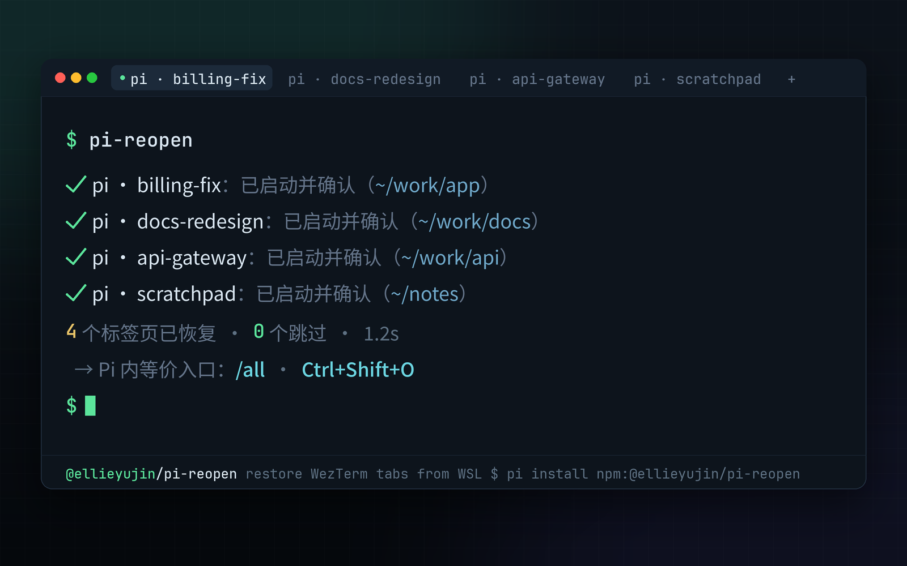

# pi-reopen

<p align="center">
  <a href="README.md">English</a> | <a href="README.zh-CN.md">简体中文</a>
</p>

一条命令，在 Pi 外恢复关闭 WezTerm 时仍打开的 Pi 终端：进入原工作目录、加载原对话、等待你输入。

一个 [Pi](https://github.com/earendil-works/pi) 包：Pi 扩展实时登记每个打开的 Pi，独立 CLI `pi-reopen` 通过 Windows [WezTerm](https://wezm.dev/) 把它们重新开成标签页，带环境预检、去重与并发保护。



## 环境要求

- **WSL（Windows）+ Windows WezTerm**：唯一的恢复目标环境
- Node ≥ 22.19，已安装 [Pi](https://github.com/earendil-works/pi)
- Linux（非 WSL）/ macOS / Windows 原生：不支持（恢复与存活判定依赖 WSL / Linux）
- 恢复使用目标 WSL 发行版的默认用户，请以该用户运行本工具

## 使用

```bash
pi-reopen
```

```text
  ✔ pi-workspace：已启动并确认（/home/ellie/work/MY/code/pi-workspace）
  ⚠ other-proj：已创建标签页，超时未确认 pi 启动（/home/ellie/work/other-proj）
已处理 2 个
```

Pi 内等价入口：

- `/all` — 恢复已登记的 Pi
- `/all recent` — 从近 24 小时的对话历史补选（适用于未登记的窗口）
- `/all clear` — 清空登记（不删除对话文件）
- `Ctrl+Shift+O` — 一键恢复

## 命令

| 命令 | 说明 |
| --- | --- |
| `pi-reopen`（即 `pi-reopen restore`） | 补开上次关闭时仍打开的 Pi；已运行的跳过 |
| `pi-reopen restore --dry-run` | 只看计划，不开标签页 |
| `pi-reopen restore --no-wait` | 跳过等待各 pi 启动确认 |
| `pi-reopen list` | 查看登记成员与状态；长内容默认截断到终端宽度 |
| `pi-reopen list --wide` | 不截断 |
| `pi-reopen doctor` | 环境检查（WSL 发行版 / 互操作套接字 / WezTerm / pi） |
| `pi-reopen clear` | 清空登记与启动占用（不删除对话文件与旧格式记录） |

`list` 状态：运行中 / 待恢复 / 启动占用中 / 工作目录缺失 / 会话文件缺失 / 重复条目。

退出码：0 成功；1 恢复失败或未知命令；2 环境预检未通过。

## 安装

### 从 npm 安装

请使用完整包名 `@ellieyujin/pi-reopen`，安装通道为 `next`。npm 上无 scope 的 `pi-workspace` 是其他作者的项目。

```bash
pi install npm:@ellieyujin/pi-reopen@next
npm install -g @ellieyujin/pi-reopen@next --omit=peer
pi-reopen doctor
```

- `pi install` 注册并加载扩展，但不保证 CLI 出现在普通 Shell 的 PATH 中；`npm install -g` 安装外部 CLI（npm 全局 bin 目录也需在 PATH 中）
- CLI 不依赖 Pi 的 peer 包，故用 `--omit=peer` 避免额外安装宿主；两份安装需分别更新，并保持版本一致

**登记必须启用扩展**：仅装 CLI 无法记录会话。安装后在每个已打开的 Pi 中运行 `/reload` 或重启；新安装无法精准找回此前未登记的窗口。不要同时加载旧的 `open-all.ts` 副本/符号链接与 package；迁移前先检查 `pi list` 和个人扩展目录，仅停用旧入口，不删除会话或认证文件。

### 从源码安装

以下命令在 WSL 内运行，安装的是当前检出的源码：

```bash
git clone https://github.com/AuthurX/pi-workspace.git
cd pi-workspace
pi install .
mkdir -p "$HOME/.local/bin"
ln -s "$PWD/bin/pi-reopen.js" "$HOME/.local/bin/pi-reopen"
export PATH="$HOME/.local/bin:$PATH"
pi-reopen doctor
```

将 PATH 配置保存到 Shell 启动文件以便后续使用。若 CLI 链接已存在，先检查其目标，不要盲目覆盖。

只需要扩展时，也可直接安装已推送的 Git 版本：

```bash
pi install git:github.com/AuthurX/pi-workspace
```

## 可选配置

| 环境变量 | 用途 |
| --- | --- |
| `PI_WORKSPACE_WEZTERM` | Windows WezTerm 在 WSL 中的绝对路径，例如 `/mnt/c/Program Files/WezTerm/wezterm.exe` |
| `PI_WORKSPACE_PI_BIN` | WSL 内 Pi 可执行文件的绝对路径，不含参数；不支持别名或 Shell 函数 |
| `PI_CODING_AGENT_DIR` | 使用其他 Pi 配置/登记目录；CLI 与扩展需保持一致 |
| `PI_WORKSPACE_SRC` | 仅供开发：覆盖共享 `src/` 目录，正常 package 安装无需设置 |

例如 Pi 通过 nvm、pnpm 或自定义 npm prefix 安装时，可显式指定：

```bash
export PI_WORKSPACE_PI_BIN="$(type -P pi)"
export PI_WORKSPACE_WEZTERM="/mnt/c/Program Files/WezTerm/wezterm.exe"
pi-reopen doctor
```

默认从调用方 PATH 和 Bash 登录环境查找 Pi，不猜测 npm 安装目录。恢复标签页使用预检得到的 Pi 路径，并显式传递调用方 PATH 与 agent 目录；不会把整个环境或认证信息拼入命令行。WezTerm 自动发现依次检查 PATH、常见安装位置和 `where.exe`（经 `wslpath` 转换）；自定义盘符挂载点等未覆盖布局请设置显式路径。修改环境变量后需重启 Pi 进程，`/reload` 不会读取父 Shell 的新环境。

## 工作原理

- **登记**：每个 Pi 启动时把 `{会话文件绝对路径, cwd, pid, processStart, bootId}` 实时写入 `~/.pi/agent/pi-workspace/members/`（每会话独立文件、原子替换）。
- **关闭判定**：Pi 的信号退出也会发出 `quit` 清理事件，不能仅按事件名判断。扩展在 TUI 生命周期内记录 SIGHUP/SIGTERM：信号退出保留记录；无信号的主动 `/quit` 或切换会话删除记录；reload 保留记录并清理监听器。强杀无法执行清理时记录残留。断电时最多恢复已持久化的记录，不保证未落盘的最新变化。
- **安全启动**：每个 `wezterm cli spawn` 请求 15s 无响应即终止报错，连续 3 次请求失败提前停止，避免 WezTerm 卡死时长时间空等；默认等待全部 pi 启动登记后再报告，`--no-wait` 跳过。
- **去重**：恢复前检查进程存活（pid + 启动时刻 + bootId，重启后失效 PID 不误判），并用启动声明（60s TTL + 持有者存活检测）减少重复请求。全局恢复锁（`restore.lock`，30 分钟 TTL + pid 存活 + bootId 校验）拒绝并发恢复；持锁进程死亡或 WSL 重启后可被接管。
- **安全**：预检（发行版 / 互操作套接字 / WezTerm 存在且可执行 / pi 可用）未通过绝不批量启动；绝不自动 sudo；ENOEXEC 给出修复指引；"已创建标签页"与"已确认 pi 启动"分开报告。

## 开发与测试

```bash
# 仓库根目录
npm test
npm pack --dry-run
```

```text
extensions/open-all.ts   Pi 扩展（薄适配层）：登记存活 Pi、提供 /all
src/                     共享核心（纯 JS ESM，扩展与 CLI 共用）
  paths/liveness/members/claims/plan/preflight/discover/launch/spawn/verify/restore/cli
bin/pi-reopen.js         CLI 入口（node 直接运行，免编译）
test/                    Node 内置测试（隔离目录 + 注入式模拟，无真实终端调用）
docs/                    需求与状态
```

测试覆盖核心恢复、信号处理顺序、reload 清理、`/all recent` 补选、非标准 Pi 安装路径、Shell 转义及 package 移动后的加载；测试通过临时目录和模拟启动器隔离。测试钩子 `PI_WORKSPACE_HOOKS` 不应在正常使用时设置。

可选 Pi PTY 测试：`python test/pty-shutdown.py`。使用临时配置和会话，检查信号退出保留成员、主动 `/quit` 删除成员；不调用模型、不打开可见标签页。

维护者发布步骤见 [发布指南](docs/PUBLISHING.md)。

## 贡献者

- [AuthurX](https://github.com/AuthurX)
- [abelxiaoxing](https://github.com/abelxiaoxing)

## 许可

[MIT](LICENSE)，Copyright (c) 2026 ellieyujin
